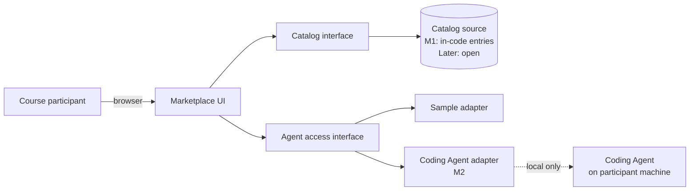
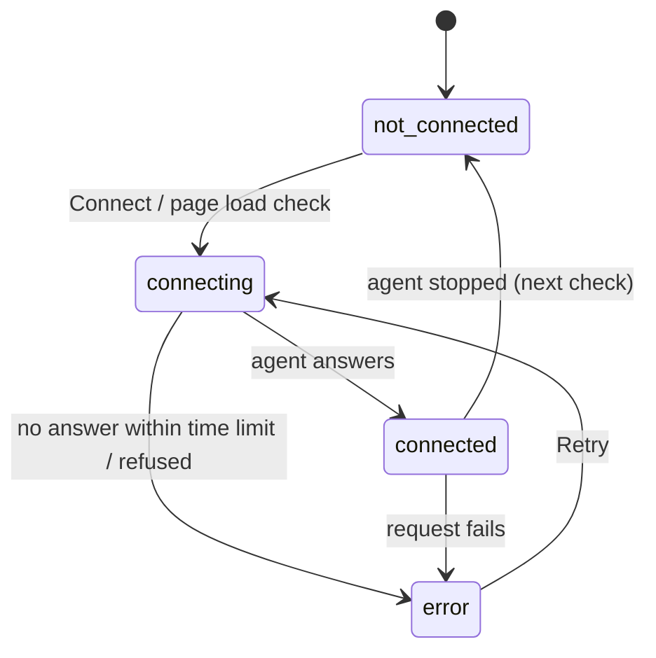

# Agent Marketplace — Architecture

| | |
|---|---|
| **Status** | Draft — Milestones 1–2; storage and data access deliberately open |
| **Date** | 2026-10-22 |
| **Related** | [PRD](PRD.md) · [Design Guidelines](Design-Guidelines.md) · [Dev Plan](Dev-Plan.md) · [Test Plan](Test-Plan.md) |

## 1. Principles

1. **The UI never knows where data comes from.** It reads entries through one catalog interface.
2. **The UI never knows how an agent is reached.** Every agent sits behind an adapter with the same shape.
3. **Storage is a later lesson.** No component may assume a database, schema or data-access library.
4. **Each milestone adds; none rewrites.** New capability arrives as a new implementation of an existing interface or a new component beside the existing ones.
5. **Local first.** Through M2, everything runs on the participant's machine.

## 2. System context



In M1 the Coding Agent adapter reports a fixed **Not connected** status and never contacts the agent. In M2 it contacts the agent for real.

## 3. Components

| Component | Responsibility | M1 | M2 |
|---|---|---|---|
| **Catalog view** | List entries as cards | ✔ | ✔ |
| **Detail view** | Show one entry, its status and available actions | ✔ | ✔ + connect / send request |
| **Router** | Map addresses to views; handle unknown entries; preserve return position | ✔ | ✔ |
| **Catalog interface** | `list()` and `get(id)` over entries | ✔ | ✔ |
| **In-code catalog source** | The three entries, defined in the codebase | ✔ | ✔ |
| **Agent access interface** | Status, connect and send for an entry | ✔ (static status) | ✔ |
| **Sample adapter** | Always reports Sample; refuses to send | ✔ | ✔ |
| **Coding Agent adapter** | Reach the local Coding Agent | Static "Not connected" | Live |
| **Local bridge** (conditional) | A small local server between browser and agent, only if the agent can't be reached safely from the browser directly | — | If ADR-005 requires it |

## 4. Interfaces

Written as language-neutral signatures; the real types follow whatever stack is chosen.

### 4.1 Domain model

```text
AgentEntry
  id                string     stable, URL-safe (e.g. "coding-agent")
  name              string
  summary           string     one line, shown on the card
  description       string     full text, shown on the detail view
  kind              "sample" | "local"
  capabilities      string[]   what it is for, in plain words (optional)

AgentStatus
  state             "sample" | "not_connected" | "connecting" | "connected" | "error"
  message           string     one-sentence explanation shown to the user
  checkedAt         timestamp  when the status was last determined (M2)
```

`kind` is a property of the entry (it doesn't change at run time). `state` is computed by the adapter and can change.

### 4.2 Catalog interface

```text
AgentCatalog
  list()      -> AgentEntry[]           ordered as they should be displayed
  get(id)     -> AgentEntry | NotFound
```

Every catalog source — the in-code one now, whatever storage is chosen later — implements exactly this and passes the same contract tests ([Test Plan](Test-Plan.md) §5).

### 4.3 Agent access interface

```text
AgentAdapter
  status()            -> AgentStatus
  connect()           -> AgentStatus           no-op for samples
  send(request)       -> AgentReply | AgentError
                                                samples: always "not available"

AgentAdapters
  for(entry)          -> AgentAdapter          picks the adapter for an entry
```

Requests and replies are kept minimal in M2 (text in, text out) until T2.1 confirms what the Coding Agent accepts.

## 5. Milestone 1 runtime

- Two routes: **catalog** (`/`) and **detail** (`/agents/{id}`). Anything else → not found.
- Data: three `AgentEntry` records in the in-code catalog source.
- Status: Samples → `sample`; Coding Agent → `not_connected` (static, no contact attempted).
- Return navigation uses browser history, so the back control and the browser back button behave the same. The catalog view restores scroll position and focus.
- No server-side component, network call or database is needed.

## 6. Milestone 2 — connecting the Coding Agent

### 6.1 What has to be learned first (T2.1)

The Coding Agent already exists locally. Before building the adapter, find out:

- How it runs (long-running process, command run per request, editor extension, …).
- What interface it exposes, if any (local HTTP, standard input/output, a CLI, …).
- Whether it needs credentials, and where they live.
- How long a typical request takes.

### 6.2 Connection options (ADR-005)

| Option | When it fits | Consequence |
|---|---|---|
| **A. Browser calls the agent directly** | Agent exposes a local HTTP endpoint, needs no secrets in the browser, and allows browser requests | No extra component |
| **B. Small local bridge** | Agent is a CLI/process, needs credentials, or can't accept browser requests | Adds one local server: the browser calls the bridge, the bridge talks to the agent. The UI still only sees `AgentAdapter`. |

Either way the bridge or endpoint listens on the local machine only (NFR-2.1) and keeps credentials out of the browser (NFR-2.2).

### 6.3 Status flow



Time limits and the check interval are set in T2.4 and recorded here.

## 7. Data and storage — deliberately open

The database and data-access approach are decided in later lessons. Until then:

- The only data is the three entries, held in the in-code catalog source.
- No component outside the catalog source knows how entries are stored.
- When storage is chosen, a new catalog source implements `AgentCatalog`, passes the contract tests, and replaces the in-code source by configuration. Views and adapters don't change.

Questions the lesson on storage will need to answer: where entries live, who can add or edit them, whether per-user data exists (connections, history), and how entries are versioned.

## 8. Security and safety

- Everything binds to the local machine through M2; nothing is exposed to the network.
- No credentials in browser code, storage or URLs.
- The marketplace grants the Coding Agent no permissions beyond what it already has; it only forwards the participant's request.
- Requests sent to the agent are length-limited, and replies are shown as text (never executed or injected as HTML).
- Samples have no execution path at all.

## 9. Suggested layout

Stack-neutral; adapt names to the chosen framework.

```text
docs/                 these planning documents
src/
  catalog/            AgentEntry, AgentCatalog, in-code source
  agents/             AgentStatus, AgentAdapter, sample + coding-agent adapters
  ui/                 catalog view, detail view, status badge, router
  bridge/             (M2, only if ADR-005 = B)
tests/
  contract/           catalog + adapter contract suites
  unit/
  e2e/
```

## 10. Decision log

| ID | Decision | Status |
|---|---|---|
| ADR-001 | UI reads entries only through `AgentCatalog` | Accepted |
| ADR-002 | Every agent sits behind `AgentAdapter` | Accepted |
| ADR-003 | Database / storage | **Open — later lesson** |
| ADR-004 | Data-access approach | **Open — later lesson** |
| ADR-005 | How the marketplace reaches the Coding Agent (A direct / B bridge) | Open — decided in M2, T2.1 |
| ADR-006 | Technology stack / framework | Open — not in agreed scope |

## 11. Evolution

| Stage | Adds | Interfaces touched |
|---|---|---|
| M1 | Catalog + detail views, in-code entries, static statuses | Introduces `AgentCatalog`, `AgentAdapter` |
| M2 | Live Coding Agent adapter, maybe a local bridge | New implementation of `AgentAdapter` |
| Later — storage | Persistent catalog source | New implementation of `AgentCatalog` |
| Later — real samples | Working Document Summarizer / Data Assistant | New adapters; entries change `kind` |
| Later — authoring, search, identity | Add/edit flows, filtering, users | New interfaces, scoped when introduced |
